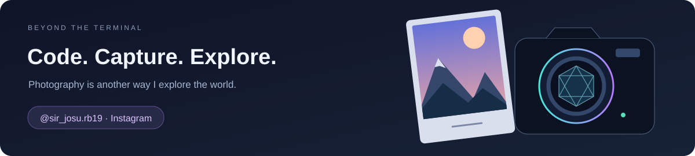

  

  
  
  

  <b>Backend developer in training. Cloud builder. Curious about security.</b> 
  Turning what I learn into APIs, cloud projects and practical experiments.

---

### ⚡ A little about me

I'm **Josue Ramírez Borja**, an Information Systems Engineering student at **Universidad Internacional del Ecuador (UIDE)**, currently in my fifth semester, based in **Quito, Ecuador**.

I build projects with **Python, FastAPI and AWS**, explore **Linux and system administration**, and study how to make applications more secure. I enjoy connecting the pieces: an interface, an API, a database and the infrastructure behind them.

Outside the terminal, I enjoy **photography** — another way to experiment, notice details and tell stories.

  
  
  

### 🛠️ My toolkit

  

**Backend & data** · REST APIs, SQL, SQLModel, SQLite, DynamoDB  
**Cloud & delivery** · EC2, S3, GitHub Actions, OIDC, Docker  
**Systems & security** · Linux, Windows Server, Active Directory, Wireshark

### 🚀 Projects from my workspace

<table>
<tr>
<td width="50%" valign="top">

#### 🔗 [Nexo · AWS URL Shortener](https://github.com/JosueRBorja/acortador-enlaces-aws)

An application that connects a web interface to a FastAPI backend and DynamoDB storage. Includes URL creation, HTTP redirects, a local development setup and automated tests.

</td>
<td width="50%" valign="top">

#### 📚 [Library API](https://github.com/JosueRBorja/api-biblioteca)

A REST API for managing books and users. A practical project in database models, CRUD operations and HTTP error handling.

</td>
</tr>
<tr>
<td width="50%" valign="top">

#### ☁️ [VideoTube Lite · Learning Fork](https://github.com/JosueRBorja/videotube-lite-)

A static interface and an example of deployment to S3 using GitHub Actions and OIDC. Learning fork of [LeirBaGMC's original project](https://github.com/LeirBaGMC/videotube-lite-).

</td>
<td width="50%" valign="top">

#### 🎨 [Web Portfolio](https://github.com/JosueRBorja/Portafolio-HTML-JRB)

A personal web development project built with HTML and CSS, bringing together my presentation, interests and visual experimentation.

</td>
</tr>
</table>

### 🧠 Always learning

- **Cloud:** AWS training in VPC, IAM, billing, shared responsibility and SimuLearn.
- **Development:** completed coursework in Python, Java, HTML and CSS.
- **Systems:** Linux Essentials and Microsoft Learn coursework in Group Policy and Active Directory.
- **Collaboration:** IEEE Student Member, AWS club participation and GitHub Foundations coursework.

<b>🇪🇨 Un poco sobre mí, en español</b>

Soy estudiante de quinto semestre de Ingeniería en Sistemas de la Información en la UIDE. Desarrollo proyectos con Python, FastAPI y AWS, y me interesan la ciberseguridad, Linux y la administración de sistemas. Me gusta aprender construyendo, entender cómo funcionan las cosas y compartir el proceso. Fuera del código, disfruto la fotografía y explorar el mundo a través de una cámara.

 

  <b>More than code. A way to build, explore and create.</b>  
  

