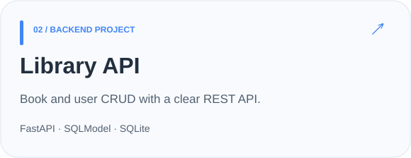
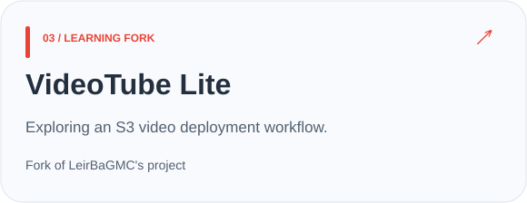
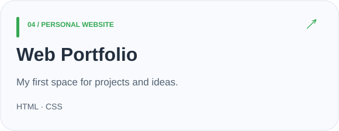
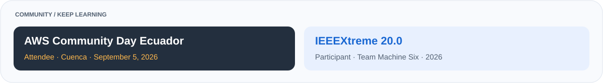
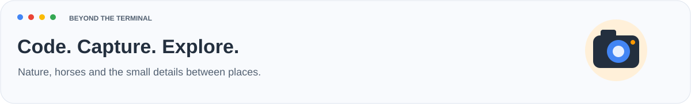
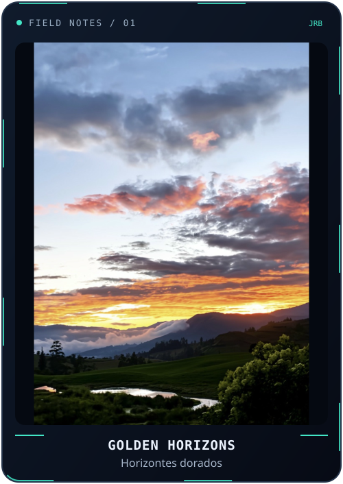

  

  <a href="#about-me">About</a> &nbsp;·&nbsp;
  <a href="#selected-projects">Projects</a> &nbsp;·&nbsp;
  <a href="#tools--learning">Toolkit</a> &nbsp;·&nbsp;
  <a href="#community">Community</a> &nbsp;·&nbsp;
  <a href="#beyond-the-terminal">Photography</a>

  <b>Backend developer in training. Building with Python, React and AWS.</b> 
  Aprendo construyendo: una idea, una API y un proyecto a la vez.

  
  
  

## About me

I'm **Josue Ramírez Borja**, an Information Systems Engineering student at **Universidad Internacional del Ecuador (UIDE)**, based in **Quito, Ecuador**.

I enjoy connecting interfaces, APIs and databases, then understanding the infrastructure behind them. My focus is **backend development and cloud**, with a growing interest in **Linux, system administration and application security**.

Outside the terminal, you'll find me with a camera, exploring nature or spending time around horses.

  

## Selected projects

**[Explore EcoRAEE Cloud →](https://github.com/JosueRBorja/Sistema-Empresarial)** &nbsp;·&nbsp; [Preserved version: v0.1.0-personal](https://github.com/JosueRBorja/Sistema-Empresarial/tree/v0.1.0-personal)

A personal application that connects a customer storefront with sales, technical assessment, inventory and finance. It includes a shopping cart, equipment trade-ins, staff permissions, installment tracking and electronic-waste traceability. Built with **React + Vite, FastAPI and SQLite**, with components organized using **Atomic Design**.

The current prototype runs entirely **locally**, with demo data and simulated payments.

<table>
<tr>
<td width="50%" valign="top"> <a href="https://github.com/JosueRBorja/acortador-enlaces-aws"><b>Explore Nexo →</b></a></td>
<td width="50%" valign="top"> <a href="https://github.com/JosueRBorja/api-biblioteca"><b>Explore Library API →</b></a></td>
</tr>
<tr>
<td width="50%" valign="top"> <a href="https://github.com/JosueRBorja/videotube-lite-"><b>Explore the learning fork →</b></a></td>
<td width="50%" valign="top"> <a href="https://github.com/JosueRBorja/Portafolio-HTML-JRB"><b>Explore my portfolio →</b></a></td>
</tr>
</table>

## Tools & learning

  

| Area | What I'm exploring |
| :--- | :--- |
| Backend & data | REST APIs, validation, relational data and automated tests |
| Cloud & delivery | AWS VPC, IAM, EC2, S3, OIDC and GitHub Actions |
| Systems & security | Linux, Windows Server, Active Directory and Wireshark |
| Other languages | Coursework and experiments with Go and Java |

<b>Learning path</b>

- **AWS:** training in VPC, IAM, billing, shared responsibility and SimuLearn.
- **Development:** coursework in Python, Java, HTML and CSS; practice through personal projects.
- **Systems:** Linux Essentials and Microsoft Learn coursework in Group Policy and Active Directory.
- **Collaboration:** GitHub Foundations coursework, IEEE Student Member and AWS club participation.

## Community

[View my AWS Community Day participation certificate →](https://drive.google.com/file/d/1dHtHN4zPq9qZnJJxpIwF2b5SEjUHkut_/view?usp=sharing)

I enjoy spaces where people share what they're building, solve problems together and make room for new learners.

## Beyond the terminal

<b>📸 Mostrar / ocultar mi galería · Open / close photo gallery</b>

 

<table>
<tr>
<td width="33%" align="center" valign="top"></td>
<td width="33%" align="center" valign="top"></td>
<td width="33%" align="center" valign="top"></td>
</tr>
<tr>
<td width="33%" align="center" valign="top"></td>
<td width="33%" align="center" valign="top"></td>
<td width="33%" align="center" valign="top"></td>
</tr>
</table>

<a href="https://www.instagram.com/sir_josu.rb19/"><b>Explore my photography on Instagram → @sir_josu.rb19</b></a>

## Activity

<picture>
  <source media="(prefers-color-scheme: dark)" srcset="https://raw.githubusercontent.com/JosueRBorja/JosueRBorja/snake-output/github-snake-dark.svg" />
  <source media="(prefers-color-scheme: light)" srcset="https://raw.githubusercontent.com/JosueRBorja/JosueRBorja/snake-output/github-snake.svg" />
  
</picture>

<b>🇪🇨 Un poco sobre mí, en español</b>

Soy Josue Ramírez Borja, estudiante de Ingeniería en Sistemas de la Información en la UIDE, en Quito. Me gusta desarrollar aplicaciones, conectar sus componentes y entender cómo funcionan por dentro. Trabajo en proyectos con Python, FastAPI y React, mientras sigo aprendiendo sobre AWS, Linux y seguridad.

EcoRAEE Cloud es uno de mis proyectos personales: reúne una tienda, ventas, taller, inventario, finanzas y trazabilidad de equipos electrónicos. Su versión actual funciona de manera local.

Fuera del código disfruto la fotografía, la naturaleza y los caballos. Este espacio reúne lo que voy aprendiendo y construyendo.

---

  <b>Build something useful. Stay curious.</b> 
  Backend · Cloud · Photography &nbsp; / &nbsp; Quito, Ecuador

