

  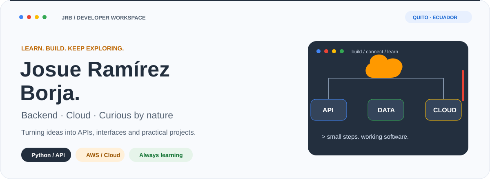

  <a href="#about-me">About</a> &nbsp;·&nbsp;
  <a href="#selected-projects">Projects</a> &nbsp;·&nbsp;
  <a href="#tools--learning">Toolkit</a> &nbsp;·&nbsp;
  <a href="#community">Community</a> &nbsp;·&nbsp;
  <a href="#beyond-the-terminal">Photography</a>

  <b>Full Stack Developer · Backend & Cloud · Python, FastAPI, React & AWS.</b> 
  Aprendo construyendo: una idea, una API y un proyecto a la vez.

  
  
  

## About me

I'm **Josue Ramírez Borja**, a **full stack developer with a focus on backend development and cloud**, based in **Quito, Ecuador**. I build applications with **Python, FastAPI and React**, and work on cloud projects with **AWS**.

My projects connect interfaces, REST APIs and databases, with attention to code organization, validation and testing. I also explore **Linux, system administration and application security**.

Alongside my projects, I'm studying **Information Systems Engineering at Universidad Internacional del Ecuador (UIDE)**.

Outside the terminal, you'll find me with a camera, exploring nature or spending time around horses.

  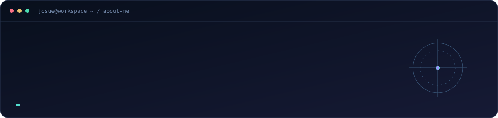

## Selected projects

Start with my full-stack applications and backend/cloud projects. Each repository documents its scope, setup and current limitations.

<a href="https://github.com/JosueRBorja/Sistema-Empresarial">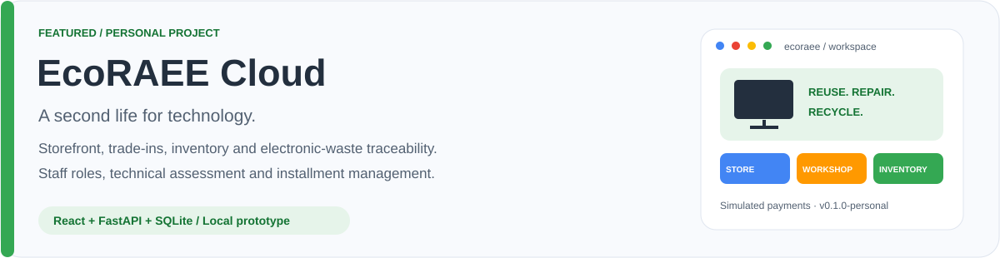</a>

**[Explore EcoRAEE Cloud →](https://github.com/JosueRBorja/Sistema-Empresarial)** &nbsp;·&nbsp; [Preserved version: v0.1.0-personal](https://github.com/JosueRBorja/Sistema-Empresarial/tree/v0.1.0-personal)

A personal application that connects a customer storefront with sales, technical assessment, inventory and finance. It includes a shopping cart, equipment trade-ins, staff permissions, installment tracking and electronic-waste traceability. Built with **React + Vite, FastAPI and SQLite**, with components organized using **Atomic Design**.

The current prototype runs entirely **locally**, with demo data and simulated payments.

[View the storefront screenshot and setup guide →](https://github.com/JosueRBorja/Sistema-Empresarial#vista-de-la-aplicación)

<table>
<tr>
<td width="50%" valign="top"><a href="https://github.com/JosueRBorja/acortador-enlaces-aws">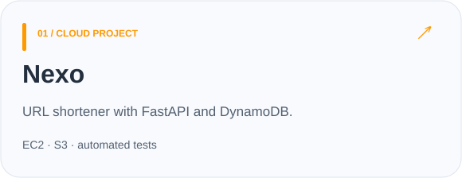</a> <a href="https://github.com/JosueRBorja/acortador-enlaces-aws"><b>Explore Nexo →</b></a></td>
<td width="50%" valign="top"><a href="https://github.com/JosueRBorja/inspira-proyect">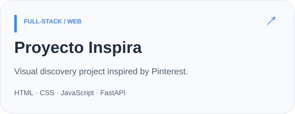</a> <a href="https://github.com/JosueRBorja/inspira-proyect"><b>Explore Proyecto Inspira →</b></a></td>
</tr>
<tr>
<td width="50%" valign="top"><a href="https://github.com/JosueRBorja/EXAMEN1">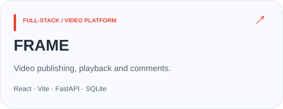</a> <a href="https://github.com/JosueRBorja/EXAMEN1"><b>Explore FRAME →</b></a></td>
<td width="50%" valign="top"><a href="https://github.com/JosueRBorja/API-FastAPI-con-Amazon-RDS">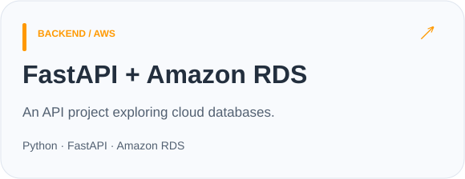</a> <a href="https://github.com/JosueRBorja/API-FastAPI-con-Amazon-RDS"><b>Explore FastAPI + Amazon RDS →</b></a></td>
</tr>
<tr>
<td width="50%" valign="top"> <a href="https://github.com/JosueRBorja/api-biblioteca"><b>Explore Library API →</b></a></td>
<td width="50%" valign="top"> <a href="https://github.com/JosueRBorja/Portafolio-HTML-JRB"><b>Explore my portfolio →</b></a></td>
</tr>
</table>

<b>Explore 4 more projects: deployment practice, Go, store & video interface</b>

<table>
<tr>
<td width="50%" valign="top"> <a href="https://github.com/JosueRBorja/videotube-lite-"><b>Explore the learning fork →</b></a></td>
<td width="50%" valign="top"><a href="https://github.com/JosueRBorja/Programacion-gestor-de-e-commerce">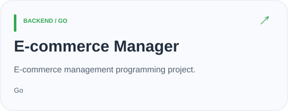</a> <a href="https://github.com/JosueRBorja/Programacion-gestor-de-e-commerce"><b>Explore E-commerce Manager →</b></a></td>
</tr>
<tr>
<td width="50%" valign="top"><a href="https://github.com/JosueRBorja/Examen_Web_JRB">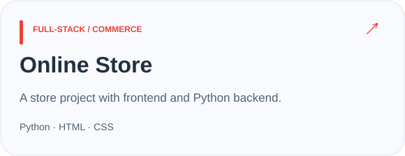</a> <a href="https://github.com/JosueRBorja/Examen_Web_JRB"><b>Explore Online Store →</b></a></td>
<td width="50%" valign="top"><a href="https://github.com/JosueRBorja/Prototipo-de-youtube">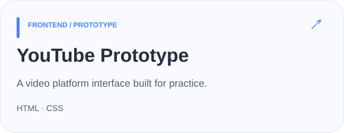</a> <a href="https://github.com/JosueRBorja/Prototipo-de-youtube"><b>Explore YouTube Prototype →</b></a></td>
</tr>
</table>

### Complete project directory

All **33 public project repositories** remain accessible here. Applications are featured above; earlier versions, programming exercises and GitHub Skills labs are grouped below.

<b>Open programming, web & security projects (15)</b>

| Repository | Focus |
| :--- | :--- |
| [Password exercise · empty archive](https://github.com/JosueRBorja/Decifrado_de_contrase-as) | Reserved archive; no source files currently published. |
| [Password search · local lab](https://github.com/JosueRBorja/Decifrado_de_contrase-as.) | Local combinatorial-search exercise. |
| [Login · initial exercise](https://github.com/JosueRBorja/clave) | FastAPI login example preserved as text files. |
| [Keyboard events · lab](https://github.com/JosueRBorja/teclado) | Local input-event observation exercise. |
| [XOR cipher · practice](https://github.com/JosueRBorja/Cifrado) | Reversible text transformation exercise. |
| [AddRoundKey](https://github.com/JosueRBorja/Add-round-key) | XOR operation on state and round-key matrices. |
| [AES transformations](https://github.com/JosueRBorja/AES) | Learning implementation; original team credits retained. |
| [FastAPI experiments](https://github.com/JosueRBorja/Pruebas_FastApi) | Initial user routes and data validation. |
| [Login API](https://github.com/JosueRBorja/Login_fastapi) | Registration and credential-validation practice. |
| [Sequential search · lab](https://github.com/JosueRBorja/Bruteforce_SIR_Josue) | Local enumeration and complexity exercise. |
| [Vulnerable authentication · lab](https://github.com/JosueRBorja/api-y-ataque-de-seguridad-) | Deliberately vulnerable local teaching API. |
| [Keyboard logging · experiment](https://github.com/JosueRBorja/simple-virus) | Historical repository name; local keyboard-event study. |
| [XOR encoder / decoder](https://github.com/JosueRBorja/Encriptador-Desencriptado-xor) | Python encryption and decryption exercise. |
| [First HTML page](https://github.com/JosueRBorja/html) | Initial frontend practice. |
| [Inspira · earlier mockup](https://github.com/JosueRBorja/proyecto-inspira) | Static predecessor of the integrated application. |

<b>Open GitHub Skills learning labs (7)</b>

| Repository | Focus |
| :--- | :--- |
| [skills-introduction-to-git](https://github.com/JosueRBorja/skills-introduction-to-git) | GitHub Skills: introduction to git. |
| [skills-introduction-to-codeql](https://github.com/JosueRBorja/skills-introduction-to-codeql) | GitHub Skills: introduction to codeql. |
| [skills-getting-started-with-github-copilot](https://github.com/JosueRBorja/skills-getting-started-with-github-copilot) | GitHub Skills: getting started with github copilot. |
| [skills-communicate-using-markdown](https://github.com/JosueRBorja/skills-communicate-using-markdown) | GitHub Skills: communicate using markdown. |
| [skills-secure-repository-supply-chain](https://github.com/JosueRBorja/skills-secure-repository-supply-chain) | GitHub Skills: secure repository supply chain. |
| [skills-review-pull-requests](https://github.com/JosueRBorja/skills-review-pull-requests) | GitHub Skills: review pull requests. |
| [skills-connect-the-dots](https://github.com/JosueRBorja/skills-connect-the-dots) | GitHub Skills: connect the dots. |

## Tools & learning

  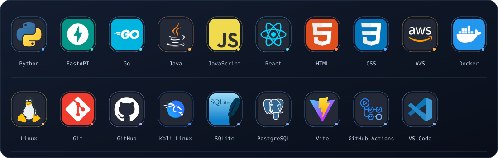

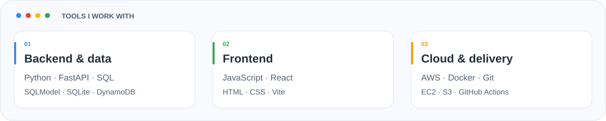

The icons show tools I've used or explored; they are not proficiency ratings.

| Focus | Evidence in my repositories |
| :--- | :--- |
| Full-stack applications | [FRAME](https://github.com/JosueRBorja/EXAMEN1): video publishing, playback and comments. [EcoRAEE](https://github.com/JosueRBorja/Sistema-Empresarial): React, FastAPI, SQLite, roles and business workflows. [Inspira](https://github.com/JosueRBorja/inspira-proyect): web interface, API and image storage. |
| Backend & data | [Library API](https://github.com/JosueRBorja/api-biblioteca): CRUD with SQLModel. [RDS API](https://github.com/JosueRBorja/API-FastAPI-con-Amazon-RDS): PostgreSQL configuration and modular routes. |
| Cloud & delivery | [Nexo](https://github.com/JosueRBorja/acortador-enlaces-aws): EC2, S3, DynamoDB and tests. [VideoTube Lite](https://github.com/JosueRBorja/videotube-lite-): learning fork with an S3/GitHub Actions workflow. |
| Continuing practice | Go, Java, Linux, system administration and security through coursework and labs. |

<b>Learning path</b>

- **AWS:** training in VPC, IAM, billing, shared responsibility and SimuLearn.
- **Development:** coursework in Python, Java, HTML and CSS; practice through personal projects.
- **Systems:** Linux Essentials and Microsoft Learn coursework in Group Policy and Active Directory.
- **Collaboration:** GitHub Foundations coursework, IEEE Student Member and AWS club participation.

## Community

[View my AWS Community Day participation certificate →](https://drive.google.com/file/d/1dHtHN4zPq9qZnJJxpIwF2b5SEjUHkut_/view?usp=sharing)

I enjoy spaces where people share what they're building, solve problems together and make room for new learners.

## Beyond the terminal

<b>📸 Mostrar / ocultar mi galería · Open / close photo gallery</b>

 

<table>
<tr>
<td width="33%" align="center" valign="top"></td>
<td width="33%" align="center" valign="top"><a href="https://www.instagram.com/sir_josu.rb19/">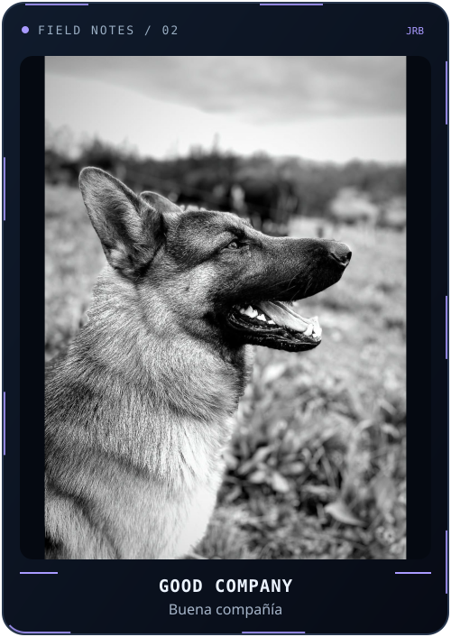</a></td>
<td width="33%" align="center" valign="top"><a href="https://www.instagram.com/sir_josu.rb19/">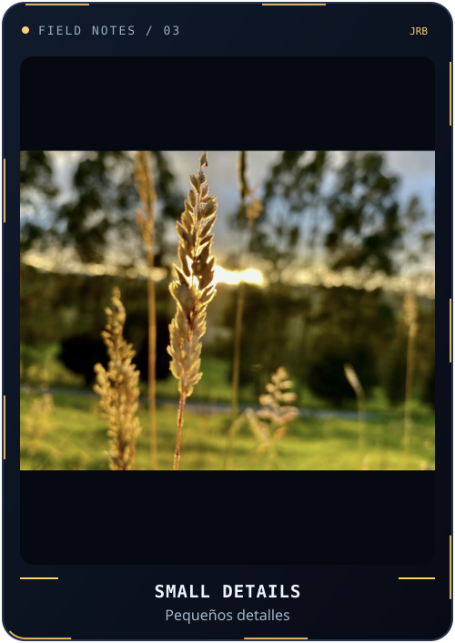</a></td>
</tr>
<tr>
<td width="33%" align="center" valign="top"><a href="https://www.instagram.com/sir_josu.rb19/">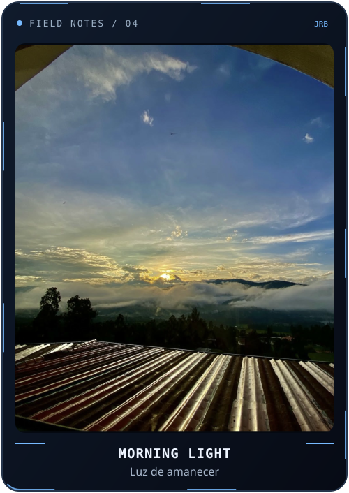</a></td>
<td width="33%" align="center" valign="top"><a href="https://www.instagram.com/sir_josu.rb19/">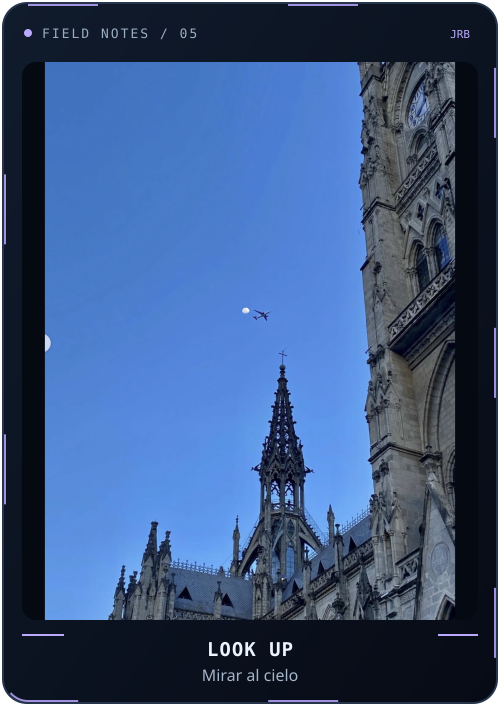</a></td>
<td width="33%" align="center" valign="top"><a href="https://www.instagram.com/sir_josu.rb19/">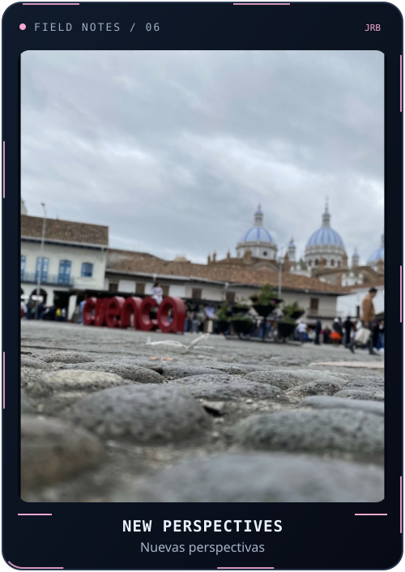</a></td>
</tr>
</table>

<a href="https://www.instagram.com/sir_josu.rb19/"><b>Explore my photography on Instagram → @sir_josu.rb19</b></a>

## Activity

<picture>
  <source media="(prefers-color-scheme: dark)" srcset="https://raw.githubusercontent.com/JosueRBorja/JosueRBorja/snake-output/github-snake-dark.svg" />
  <source media="(prefers-color-scheme: light)" srcset="https://raw.githubusercontent.com/JosueRBorja/JosueRBorja/snake-output/github-snake.svg" />
  
</picture>

<b>🇪🇨 Un poco sobre mí, en español</b>

Soy **Josue Ramírez Borja**, **desarrollador full stack con enfoque en backend y cloud**, en Quito, Ecuador. Desarrollo aplicaciones con **Python, FastAPI y React**, y trabajo en proyectos con **AWS**. Me interesa crear APIs, conectar interfaces con bases de datos y mantener el código organizado, con validaciones y pruebas.

Complemento mis proyectos con mis estudios de **Ingeniería en Sistemas de la Información en la UIDE**, y sigo profundizando en Linux, administración de sistemas y seguridad.

EcoRAEE Cloud es uno de mis proyectos personales: reúne una tienda, ventas, taller, inventario, finanzas y trazabilidad de equipos electrónicos. Su versión actual funciona de manera local.

Fuera del código disfruto la fotografía, la naturaleza y los caballos. Este espacio reúne lo que voy aprendiendo y construyendo.

---

  <b>Build something useful. Stay curious.</b> 
  Backend · Cloud · Photography &nbsp; / &nbsp; Quito, Ecuador

