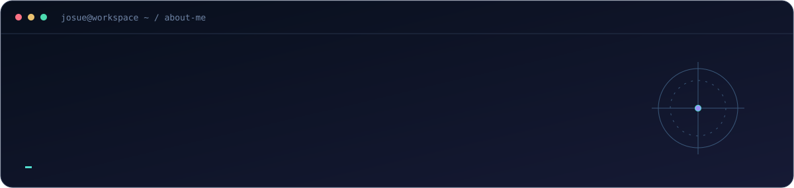
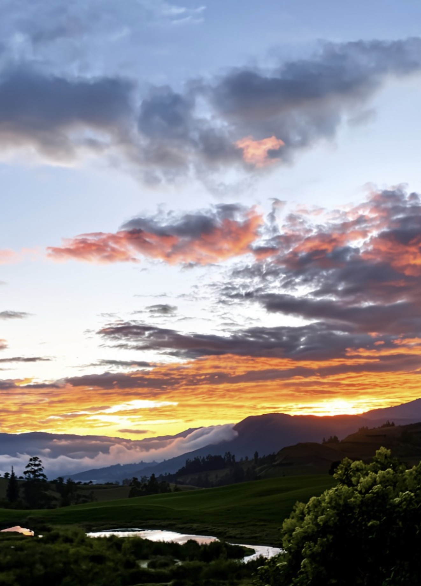
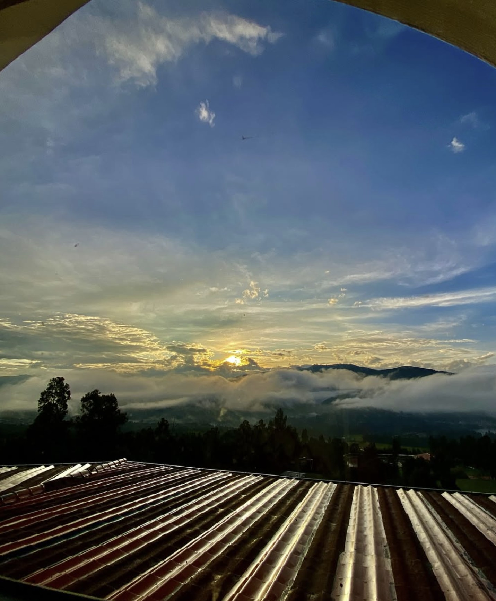
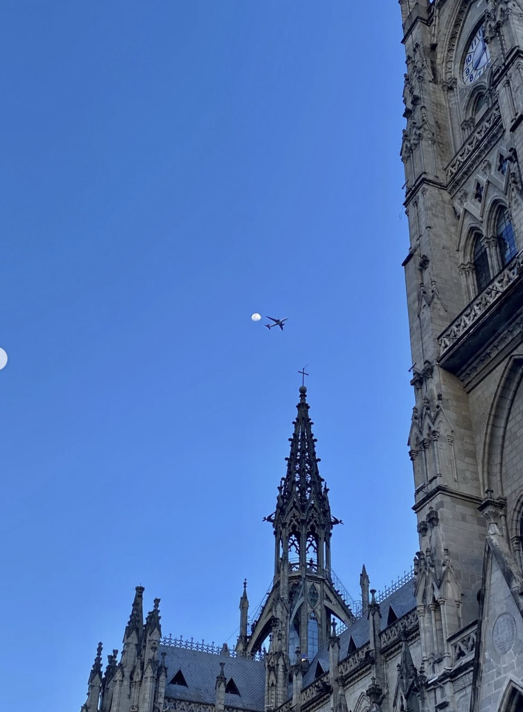
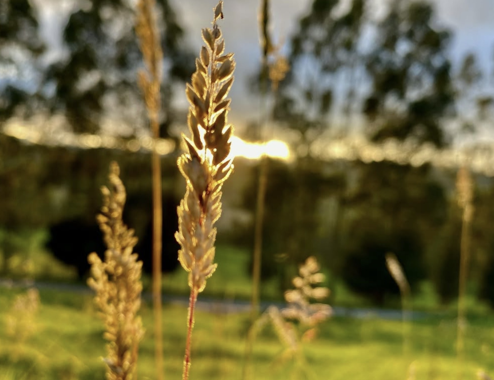
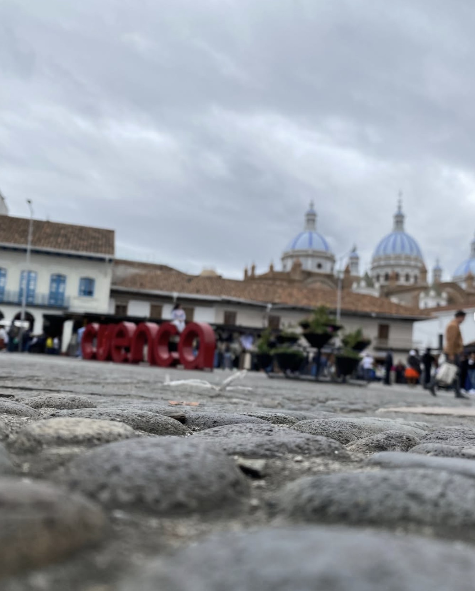

  

  
  
  

  <b>Backend developer in training. Cloud builder. Curious about security.</b> 
  Turning what I learn into APIs, cloud projects and practical experiments.

### ⚡ A little about me

I'm **Josue Ramírez Borja**, an Information Systems Engineering student at **Universidad Internacional del Ecuador (UIDE)**, currently in my fifth semester, based in **Quito, Ecuador**.

I build projects with **Python, FastAPI and AWS**, explore **Linux and system administration**, and study how to make applications more secure. I enjoy connecting the pieces: an interface, an API, a database and the infrastructure behind them.

Outside the terminal, I love **photography, nature and horses**. Capturing landscapes, noticing small details and spending time around animals inspire my curiosity and creativity.

  
  
  

### 🛠️ My toolkit

  

**Backend & data** · REST APIs, SQL, SQLModel, SQLite, DynamoDB  
**Cloud & delivery** · EC2, S3, GitHub Actions, OIDC, Docker  
**Systems & security** · Linux, Windows Server, Active Directory, Wireshark

### 🚀 Projects from my workspace

<table>
<tr>
<td width="50%"></td>
<td width="50%"></td>
</tr>
<tr>
<td width="50%"></td>
<td width="50%"></td>
</tr>
</table>

  
  
  

### 🧠 Always learning

- **Cloud:** AWS training in VPC, IAM, billing, shared responsibility and SimuLearn.
- **Development:** completed coursework in Python, Java, HTML and CSS.
- **Systems:** Linux Essentials and Microsoft Learn coursework in Group Policy and Active Directory.
- **Collaboration:** IEEE Student Member, AWS club participation and GitHub Foundations coursework.

<b>🇪🇨 Un poco sobre mí, en español</b>

Soy estudiante de quinto semestre de Ingeniería en Sistemas de la Información en la UIDE. Desarrollo proyectos con Python, FastAPI y AWS, y me interesan la ciberseguridad, Linux y la administración de sistemas. Me gusta aprender construyendo, entender cómo funcionan las cosas y compartir el proceso. Fuera del código, me encanta la fotografía y la naturaleza, y soy un amante de los caballos. Disfruto capturar paisajes, descubrir pequeños detalles y pasar tiempo cerca de los animales.

 

### 📷 Beyond the terminal

  <b>Nature, animals & the stories between places.</b> 
  Naturaleza, animales e historias entre paisajes. 
  🌿 Nature lover &nbsp;·&nbsp; 🐎 Horse lover &nbsp;·&nbsp; 📸 Photography

<table>
<tr>
<td width="33%" align="center" valign="top">
 
Golden horizons · Horizontes dorados  
 
Morning light · Luz de amanecer  
</td>
<td width="33%" align="center" valign="top">
 
Good company · Buena compañía  
 
Look up · Mirar al cielo  
</td>
<td width="33%" align="center" valign="top">
 
Small details · Pequeños detalles  
 
New perspectives · Nuevas perspectivas  
</td>
</tr>
</table>

<a href="https://www.instagram.com/sir_josu.rb19/"><b>Explore my photography on Instagram → @sir_josu.rb19</b></a>

  <b>More than code. A way to build, explore and create.</b>  
  

